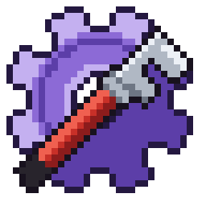

<p align="center"></p>

# Sunrise Tweaks

A client-side native mod for [Sunrise](https://github.com/sunrise-org/sunrise), the Minecraft Java 26.3 rewrite in Rust. It collects many small client tweaks in one click menu.

Press **Right Shift** to open the menu. It has one panel per category:
- **Left-click** a module to turn it on or off.
- **Right-click** a module to show its settings.
- Every module's key can be set right there.

## Modules

**Overlays**
- **Light Overlay:** marks spots where mobs can spawn. Red means always, yellow means only at night.
- **Fullbright:** everything is bright, even in caves and at night.
- **No Darkness:** no dimming and no fog from the Darkness effect (Warden).
- **No Pumpkin:** no pumpkin blur while you wear a carved pumpkin.
- **Weather:** your own weather (clear, rain or thunder). Only you see it; the world keeps its real weather.

**Automation**
- **Auto Tool:** switches to the fastest fitting tool while you mine. It can switch back afterwards and spare tools that are almost broken.
- **Autoclicker:** clicks for you, left or right, at a set CPS or whenever the attack cooldown is full. An optional HUD shows when it runs.
- **Auto Eat:** eats the best food from your hotbar when you get hungry. It skips food that poisons you.

**Conveniences**
- **Free Look:** hold a key to look around freely while you keep walking straight, in third person or first person.
- **Easy Bridge:** look down and hold right-click with a block. The block goes in front of you, like in Bedrock.

All modules use the game's normal keys and inputs. Some servers don't allow automation such as autoclickers, so check a server's rules before you use them there.

## Install

1. Download `sunrise_tweaks.smod` from the [Releases](../../releases) page.
2. Put it in your Sunrise game folder under `sunrise-native-mods/`. On Linux that is `~/.local/share/sunrise/game/sunrise-native-mods/`.
3. Start Sunrise and enable the mod in the mod menu.

The key for the click menu can be changed in *Options → Controls* or on the mod's Config page.

## Build from source

You need Rust and the Sunrise mod tool (`cargo sunrise-mod`).

```sh
cargo sunrise-mod check
cargo test
cargo sunrise-mod build
```

The packaged mod ends up in `target/sunrise-mod/sunrise_tweaks.smod`. A few modules change game code through Sunrise's native mixins (see `sunrise-mod.toml`), so the mod is pinned to the Sunrise build named there.

## License

[MIT](LICENSE)
